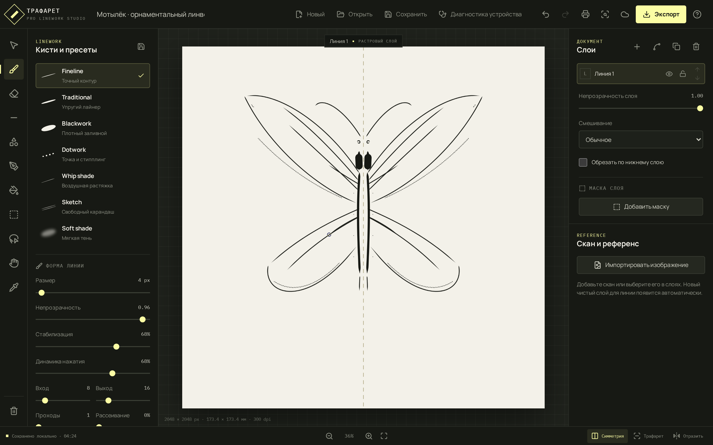

# Трафарет

**Бесплатная автономная студия тату-линворка** — от первой линии до готового трафарета. Разработано командой «Кир».

Трафарет — локальный инструмент для эскизов, линворка, обработки сканов и подготовки трафаретов к переносу. Всё работает на вашем устройстве: рисование, слои, анализ, экспорт и печать не требуют сети, аккаунтов и подписки. Инструмент не мешает рисовать.



## Сайт проекта

- **Публичная страница:** [volkohvat.github.io/trafaret](https://volkohvat.github.io/trafaret/) (публикуется из каталога `docs/` через GitHub Pages)
- Локальная копия: [docs/index.html](docs/index.html)

[](https://github.com/VolkoHvat/trafaret/releases/latest/download/Trafaret-Windows-x64.exe)
[](https://github.com/VolkoHvat/trafaret/releases/latest/download/Trafaret-Android.apk)
[](https://github.com/VolkoHvat/trafaret)

## Скачать

| Платформа | Файл | Требования |
|---|---|---|
| **Windows** | [Trafaret-Windows-x64.exe](https://github.com/VolkoHvat/trafaret/releases/latest/download/Trafaret-Windows-x64.exe) | Windows 10/11, x64 |
| **Android** | [Trafaret-Android.apk](https://github.com/VolkoHvat/trafaret/releases/latest/download/Trafaret-Android.apk) | Android 7.0+ (minSdk 24) |
| **Исходники** | [github.com/VolkoHvat/trafaret](https://github.com/VolkoHvat/trafaret) | Все платформы |

Последний выпуск: [v1.0](https://github.com/VolkoHvat/trafaret/releases/latest). Хеши и детали — в [Release Notes](docs/RELEASE_NOTES.md).

## Функционал

### Рисование
- **7 кистей линворка**: Fineline, Traditional, Blackwork, Dotwork, Whip shade, Sketch, Soft shade — каждая с настраиваемым размером, непрозрачностью, сужением, стабилизацией, streamline, затуханием, кривой давления (мягкая/линейная/жёсткая), числом проходов и джиттером; свои пресеты сохраняются.
- **Давление пера** — нативные Pointer Events с реальным давлением пера и моделированием давления для мыши/тача.
- **Predicted stroke** — короткое предсказание только в preview для более отзывчивого штриха; в документ и историю предсказанные точки не попадают.
- **Режим «только перо»** — касания пальцем игнорируются, ладонь не оставляет линий (palm rejection).
- **Touch-жесты**: двумя пальцами — масштаб и панорама (pinch-to-zoom).
- **Инструменты**: объект, кисть, ластик, линия, фигуры (прямоугольник, эллипс, дуга), перо, заливка, область, лассо, панорама, пипетка.
- **Симметрия**: вертикальная и радиальная (с настраиваемым числом сегментов); направляющие-круги и эллипсы для композиции.
- **Заливка** с допуском цвета, уважающая текущее выделение.

### Слои и выделения
- **Три типа слоёв**: растровые, векторные и image-слои (референс, скан).
- **Маски слоёв** — рисование маски, включение/выключение, удаление.
- **Обрезка по нижнему слою (clipToBelow)** и **векторные клипы** у объектов.
- **Векторные control points**: редактирование узлов пера и свободных штрихов после отрисовки, включая трансформированные объекты и Undo.
- **Line width redraw**: изменение толщины выбранной векторной линии без смены глобальной кисти, с Undo/Redo.
- **Выделения**: прямоугольник, эллипс, лассо, инверсия; заливка и рисование работают внутри выделения.
- Свойства слоя: видимость, блокировка, непрозрачность, режим наложения.

### От скана до трафарета
- **Скан и референс**: импорт изображения, фильтры — градации серого, контраст, порог, инверсия.
- **Неразрушающие фильтры для всех слоёв**: исходные пиксели и векторные объекты не меняются, эффекты сохраняются в проекте.
- **Режим трафарета**: мгновенная чёрно-белая высококонтрастная версия эскиза.
- **Локальный анализ эскиза** (без сети и AI): избыточные узлы, мелкие элементы, дубликаты, выход за край холста; плотность, дисбаланс и смещение массы композиции, безопасные поля. Это рекомендации для внимательного взгляда, а не вердикт.

### Надёжность и экспорт
- **Undo/redo** с отдельной историей растровых слоёв.
- **Экспорт**: PNG с записанным DPI (чанк pHYs — физический размер печати сохраняется), SVG из векторных слоёв, экспорт «Трафарет PNG», печать с размерами в миллиметрах.
- **Проекты `.tattoo.json`** — полный снимок документа со слоями; автосохранение в IndexedDB и восстановление после сбоя по выбору пользователя.
- **Offline/PWA** — работает без сети, ставится как приложение из браузера.
- **Встроенная локальная диагностика API**: 10 проверок Canvas 2D, pointer-событий, масок и выделений на отсоединённых canvas до 16×16. Без сети, без AI. Проверяется API-слой браузера, а не железо и не драйверы.

### Синхронизация
- **Google Drive** — ручная и автоматическая синхронизация проектов (с задержкой после локальных изменений и повторами при ошибках).
- **При конфликте версий выбор делает пользователь**: локальная или облачная копия.
- Синхронизация включается только по инициативе и настройке пользователя (нужен собственный Google Client ID; см. `public/sync-config.example.json`).

### Платформы
- **Windows** — десктопное приложение на Electron.
- **Android** — приложение на Capacitor (ru.trafaret.studio, minSdk 24, targetSdk 36).
- **Web/PWA** — тот же код в браузере.

## Скриншоты и архитектура

Реальные снимки интерфейса (все пять сняты с работающего приложения):

1. [Рабочий стол — главный экран](docs/assets/screenshots/01-desktop-hero.png)
2. [Анализ эскиза](docs/assets/screenshots/02-artwork-analysis.png)
3. [Диагностика API](docs/assets/screenshots/03-diagnostics-api.png)
4. [Планшетный режим](docs/assets/screenshots/04-tablet-working.png)
5. [Мобильный режим](docs/assets/screenshots/05-mobile-working.png)

Архитектура:

- [Интерактивная схема](docs/assets/diagrams/architecture.html) — открывается в браузере, работает офлайн
- [architecture.json](docs/assets/architecture.json) — машиночитаемое описание модулей и связей
- Диаграммы: [светлая, 1440×900](docs/assets/diagrams/architecture.visual-check.1440x900.light.png) и [тёмная, 2048×1320](docs/assets/diagrams/architecture.visual-check.2048x1320.dark.png)

## Установка

**Windows 10/11 (x64)**
1. Скачайте [Trafaret-Windows-x64.exe](https://github.com/VolkoHvat/trafaret/releases/latest/download/Trafaret-Windows-x64.exe).
2. Запустите установщик. Приложение **не имеет коммерческой кодовой подписи**, поэтому Windows SmartScreen может показать предупреждение — выберите «Подробнее» → «Выполнить в любом случае».

**Android 7.0+**
1. Скачайте [Trafaret-Android.apk](https://github.com/VolkoHvat/trafaret/releases/latest/download/Trafaret-Android.apk).
2. Разрешите установку из неизвестных источников для браузера/файлового менеджера, когда система спросит, и установите APK. Подпись APK v2/v3, сертификат см. в [Release Notes](docs/RELEASE_NOTES.md).

## Приватность

- Основная работа **полностью локальна**: рисование, слои, анализ, экспорт и автосохранение не выходят за пределы устройства.
- **Google Drive используется только для синхронизации** и только по инициативе и настройке пользователя; отключив синхронизацию, вы ничего не отправляете в облако.
- Встроенная диагностика работает офлайн и не отправляет никаких данных.
- Никакой аналитики, трекеров и обязательных аккаунтов.

## Сборка из исходников

```bash
npm install

# Web (dev-сервер)
npm run dev

# Web (production build + typecheck)
npm run build

# Линт / тесты / typecheck
npm run lint
npm test
npm run desktop:typecheck

# Windows-установщик (electron-builder → NSIS)
npm run desktop:dist

# Android APK (Capacitor + Gradle)
npm run android:apk
```

Требуется Node.js с npm; для APK — JDK и Android SDK (см. `android/`).

## Проверки (v1.0)

Результаты тестирования команды «Кир» перед публикацией v1.0:

| Проверка | Результат |
|---|---|
| Unit-тесты (Vitest) | **96/96 PASS** |
| Lint, typecheck, build | **PASS** |
| Production-регрессия (Playwright, изолированные сценарии) | **13/13 PASS** |
| Диагностика API (default / disable-gpu) | **10/10** в обоих режимах |
| Electron (default / disable-gpu) | **PASS** |
| Pen / palm / pinch (перо, ладонь, жесты) | **PASS** |
| Рендеринг: baseline vs current, GPU vs no-GPU | **pixel-identical** |
| Память, prefill | **800 МБ** против baseline 1107 МБ (**−27,7%**) |
| Память, postfill | **897 МБ** против baseline 1312 МБ (**−31,7%**) |
| Заливка (fill) | **732,31 мс** против baseline 1135,44 мс (в **1,55 раза** быстрее) |
| Маркетинговая страница (docs/) | **75/75 PASS** |
| Скриншоты работающего приложения | **5/5 PASS** — сняты и проверены |

Скрипты проверок: `npm run audit:runtime`, `npm run audit:electron`, `npm run audit:production`, `npm run audit:strictmode` (реализация — в `scripts/`).

### Что не проверено

Честный список того, что не покрыто тестами v1.0 (NOT_TESTED):

- Реальные перьевые планшеты: Wacom, WinTab, Windows Ink.
- Физический touchscreen, GPU и дигитайзер устройств (проверялся только API-слой).
- Печать на реальном принтере и бумаге.
- Реальный Google Drive с настоящими учётными данными.
- Физические устройства Windows и Android (тесты — эмуляция/автоматизация).
- Реальный запуск Windows-установщика и установка APK на устройство.

## Документы

- [Release Notes v1.0](docs/RELEASE_NOTES.md) — файлы выпуска, размеры, SHA-256.
- [Маркетинговый пакет](docs/MARKETING.md) — позиционирование и тексты команды «Кир».
- [Сайт проекта](docs/index.html) — статическая страница для GitHub Pages ([публичная версия](https://volkohvat.github.io/trafaret/)).

---

Разработано командой «Кир» · [github.com/VolkoHvat/trafaret](https://github.com/VolkoHvat/trafaret)
